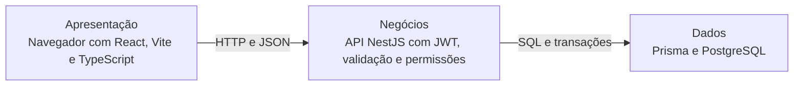

# Agenda do Engenheiro Civil

Projeto final individual de Sistemas Distribuídos da UFERSA, de **Lucas Assis da Costa Pereira**, com apresentação em **27/11/2026**. A agenda organiza pedidos de visita relacionados a topografia, CAR, INCRA e projetos. O engenheiro pode revisar os pedidos por município e comunidade e reservar horários pela agenda.

## Executar com Docker Compose

Com Docker e Compose disponíveis, copie `.env.example` para `.env` na raiz. No PowerShell, use `Copy-Item .env.example .env`. Em Linux, use `cp .env.example .env`. Preencha `POSTGRES_PASSWORD` com uma senha própria usando caracteres seguros para URL e `JWT_SECRET` com um valor aleatório de pelo menos 32 caracteres.

Para provisionar uma conta local de demonstração do engenheiro, preencha `ENGINEER_NAME`, `ENGINEER_PHONE` (celular de teste com DDD) e `ENGINEER_PASSWORD` (uma senha de 8 a 128 caracteres escolhida para a demonstração) no seu `.env`. Esse arquivo é ignorado pelo Git. Após subir os serviços, o comando `seed` cria ou atualiza a conta do engenheiro para esse celular. Se o número já pertence a um cliente, use outro número. Para trocar a senha, edite seu `.env`, execute novamente os dois comandos e entre com a nova senha.

```sh
docker compose up -d --build --wait
docker compose exec api npm run seed
```

Abra [o frontend local](http://localhost:8080). A API está em [localhost:3000](http://localhost:3000/saude). A API aplica as migrações versionadas na inicialização e o PostgreSQL fica na rede interna do Compose.

Na capa, **Entrar** e **Criar conta** são para clientes. **Pedir atendimento** leva ao formulário depois do login ou cadastro. Use **Área do profissional** no rodapé para acessar a área profissional ou a revisão administrativa. Use perfis de navegador separados para manter as sessões abertas.

### Verificar e ativar a conta profissional existente

1. Com o banco e a migração em execução, configure `ADMIN_NAME`, `ADMIN_PHONE` e `ADMIN_PASSWORD` no `.env` privado. Use um celular diferente do profissional e uma senha de pelo menos 15 caracteres. Recrie a API para carregar as variáveis e execute `docker compose exec api npm run seed:admin`. O comando recusa celulares de contas de outro perfil.
2. Entre com a conta profissional que já existe em **Área do profissional** → **Entrar como profissional** → **Verificar minha conta profissional**. Envie o nome completo, título, CREA-UF e registro conforme o cadastro oficial. Autorize a exibição na capa somente com a concordância do titular. Use a conta existente para preservar o acesso e os dados. O `seed` anterior criou uma conta com papel `ENGENHEIRO`, sem conferir identidade ou registro.
3. Em outra sessão, entre pela mesma área com a conta administrativa. Na fila **Revisão profissional**, confira nome, título, CREA-UF, número e situação do registro na [consulta oficial do Confea](https://consultaprofissional.confea.org.br/). Se necessário, confirme com o CREA responsável.
4. Confirme que o titular fez a solicitação por um canal encontrado de forma independente. Use, por exemplo, contato institucional obtido de fonte oficial ou verificação presencial. O celular informado no formulário e a consulta ao registro, por si só, são insuficientes para ligar a conta à pessoa. Evite coletar documentos ou registrar detalhes pessoais da verificação na Agenda.
5. Registre a fonte e o canal de conferência e aprove somente com as duas confirmações. Em caso de dúvida, deixe em análise ou rejeite. A Agenda guarda a conta revisora e o horário da decisão. Em seguida, atualize **Situação profissional** para liberar **Pedidos** e **Agenda**. Confira **Quem atende** em uma sessão anônima. A autorização de exibição pode ser retirada pelo profissional.

A migração preserva contas, sessões, pedidos e visitas anteriores. Uma conta com papel `ENGENHEIRO` precisa passar pela revisão para voltar a acessar os dados dos clientes. A Agenda atende um escritório com um calendário compartilhado e permite um profissional aprovado por banco. Use dados fictícios em um banco local e repita a conferência da conta real no banco da publicação durante a janela de atualização, antes de retomar o atendimento.

```sh
docker compose exec -e TEST_API_URL=http://localhost:3000 api npm test
docker compose exec api npm run test:seguranca
docker compose exec api npm run test:profissionais
docker compose down
```

Execute a suíte apenas contra um banco de demonstração. Ela cria registros fictícios e verifica cadastro e login com normalização, propriedade dos pedidos, permissões, filtros, troca de mensagens, confirmação e conclusão. Também disputa o mesmo horário entre dois pedidos e disputa horários diferentes para o mesmo pedido.

Para `npm test`, use as credenciais de um profissional fictício aprovado nas variáveis `ENGINEER_*`. A suíte `test:profissionais` cria sua própria área isolada no PostgreSQL e cobre cadastro, revisão, consentimento e agendamento.

## Variáveis de ambiente

| Variável | Uso |
| --- | --- |
| `POSTGRES_PASSWORD` | Senha do banco no Compose. Use caracteres seguros para URL, como letras, números, hífen e sublinhado. |
| `DATABASE_URL` | Conexão Prisma. O Compose monta o valor com o endereço interno `db`. |
| `JWT_SECRET` | Segredo do JWT com pelo menos 32 caracteres. |
| `CORS_ORIGINS` | Origens autorizadas, separadas por vírgulas. |
| `VITE_API_URL` | URL da API incorporada durante a compilação do frontend. |
| `ENGINEER_NAME`, `ENGINEER_PHONE`, `ENGINEER_PASSWORD` | Credenciais configuradas fora do Git para o comando `seed`. |
| `ADMIN_NAME`, `ADMIN_PHONE`, `ADMIN_PASSWORD` | Credenciais privadas do revisor para `seed:admin`. |
| `SITE_DOMAIN`, `API_DOMAIN` | Domínios do proxy HTTPS. |
| `TEST_API_URL` | Endereço da API de demonstração usado pela suíte. |

## Arquitetura



O navegador guarda o JWT na sessão da aba e envia o token no cabeçalho `Authorization: Bearer`. A API verifica assinatura, validade, sessão ativa e papel atual no PostgreSQL. A sessão vence após oito horas. **Sair** revoga a sessão da aba no servidor. Uma redefinição do engenheiro pelo `seed` encerra as sessões anteriores dessa conta.

O cadastro cria somente contas de cliente e exige uma senha de 15 a 128 caracteres. A API usa scrypt com sal aleatório por senha, com custo `N=32768`, `r=8` e `p=3`. Contas antigas seguem podendo entrar, e o hash anterior é atualizado após autenticação. Somente a conta proprietária e a conta de engenheiro podem consultar um pedido.

Os limites de autenticação usam janelas de 15 minutos na instância da API. O login aceita até 30 tentativas por IP e 8 por celular. O cadastro aceita 12 por IP e 5 por celular. O telefone é normalizado para aplicar o limite. Em caso de limite, a API retorna HTTP 429 com `Retry-After`. Esses contadores são locais ao processo e são zerados no reinício. A publicação pressupõe uma instância da API atrás do Caddy.

A mensagem de cadastro duplicado revela que o número tem conta. A limitação reduz consultas repetidas. Quando a verificação de posse estiver pronta, mostre essa orientação específica somente após confirmar o número. Na atualização de uma versão anterior a esta migração, peça aos usuários que entrem novamente para criar uma sessão revogável.

### Recuperação de conta

**Preciso de ajuda para entrar** orienta o cliente a procurar o engenheiro pelo canal que já usa. O cadastro atual valida o formato do número. A posse do celular ainda precisa ser verificada.

Para implementar a recuperação, cadastre um canal verificado e confirme a posse do celular no cadastro com um código de uso único. No pedido de recuperação, dê a mesma resposta para números existentes e inexistentes, limite tentativas e envie um código de curta validade ao canal verificado. Após o código válido, solicite uma nova senha e revogue todas as sessões anteriores. Se o cliente perdeu o número, use uma verificação independente e acordada com ele antes de mudar a conta. Saber o número, o nome ou os detalhes de um pedido é insuficiente para autorizar a troca.

A API recebe dia e hora no fuso de Brasília, aceita somente o início de cada hora e persiste o instante em PostgreSQL. O frontend exibe o mesmo instante em `America/Sao_Paulo`. O agendamento altera a situação e cria a visita em uma única transação. A atualização do pedido exige uma situação válida no banco e o índice único de horário faz uma tentativa concorrente perder com HTTP 409. A perda desfaz a alteração daquele pedido. Há também um índice único por pedido. A conclusão mantém o histórico da visita e a retira da lista de confirmadas.

### Rotas principais

| Método e rota | Acesso |
| --- | --- |
| `GET /saude` | Público. Verifica a conexão com o banco. |
| `POST /auth/cadastro`, `POST /auth/login` | Público. O cadastro cria conta de cliente. |
| `POST /auth/cadastro-profissional` | Público. Cria conta profissional em análise, com os limites do cadastro. |
| `GET /profissionais/publico` | Público. Exibe o perfil aprovado com autorização, incluindo a data da revisão. |
| `GET /profissionais/meu-perfil`, `POST /profissionais/meu-perfil`, `POST /profissionais/meu-perfil/publicacao` | Conta profissional. Acompanha sua situação, solicita revisão de conta preexistente e atualiza seu consentimento. |
| `GET /profissionais/revisao`, `POST /profissionais/revisao/:id` | Administração. Examina solicitações e registra a decisão. |
| `POST /auth/sair` | Conta autenticada. Revoga a sessão atual. |
| `POST /pedidos` | Cliente autenticado. |
| `GET /pedidos`, `GET /pedidos/:id` | Cliente consulta os próprios pedidos. Engenheiro consulta todos e pode filtrar a lista por `municipio` e `comunidade`. |
| `POST /pedidos/:id/informacoes` | Engenheiro. Envia `{ "texto": "..." }`. |
| `POST /pedidos/:id/respostas` | Dono do pedido. Envia `{ "texto": "..." }` quando há solicitação de informações. |
| `POST /pedidos/:id/conclusao` | Engenheiro. |
| `POST /visitas` | Engenheiro. Envia `pedidoId`, `dia` no formato AAAA-MM-DD e `hora` no formato HH:00. |
| `GET /visitas` | Engenheiro. Lista as visitas confirmadas por horário. |

## Publicação no AWS Academy

O Compose de publicação foi preparado para um host Linux com Docker Compose e acesso autorizado à zona DNS. Antes de apontar qualquer domínio, inventarie os registros existentes e valide com o responsável qual infraestrutura serve cada nome. Preserve as entradas das avaliações anteriores. Em uma instância autorizada, use um endpoint estável e libere 80 e 443 no grupo de segurança. Restrinja o acesso administrativo e mantenha o PostgreSQL na rede interna.

No `.env` do host, use segredos próprios e uma senha de engenheiro com pelo menos 15 caracteres. A API publicada aceita como origem de navegador apenas o endereço HTTPS do site. Ajuste:

```dotenv
SITE_DOMAIN=lucas.grupo-04.sd.ufersa.dev.br
API_DOMAIN=api.lucas.grupo-04.sd.ufersa.dev.br
CORS_ORIGINS=https://lucas.grupo-04.sd.ufersa.dev.br
VITE_API_URL=https://api.lucas.grupo-04.sd.ufersa.dev.br
```

```sh
docker compose -f compose.yaml -f compose.publicacao.yaml up -d --build --wait
docker compose -f compose.yaml -f compose.publicacao.yaml exec api npm run seed
```

O Caddy solicita e renova os certificados quando os domínios apontam para o proxy e as portas estão acessíveis. Confirme o DNS e faça a verificação de HTTPS antes de entrar com qualquer conta. O site deve retornar HTTP 200 e a saúde da API deve retornar `{"ok":true}`.

```sh
curl -fsS -o /dev/null https://lucas.grupo-04.sd.ufersa.dev.br/
curl -fsS https://api.lucas.grupo-04.sd.ufersa.dev.br/saude
```

## Roteiro de apresentação, três minutos

| Tempo | Demonstração |
| --- | --- |
| 0:00–0:35 | Apresente o problema. Um profissional autônomo recebe pedidos de localidades diferentes e precisa agrupá-los para organizar as visitas. Mostre rapidamente as três camadas. |
| 0:35–1:20 | No celular, entre como cliente fictício, escolha Topografia, escreva o município e uma referência fictícia e envie. Mostre a confirmação e o estado **Pedido recebido**. |
| 1:20–2:10 | No computador, entre como engenheiro, filtre pelo município, abra a ação **Marcar visita**, selecione um horário futuro e confirme. Mostre o próximo compromisso na **Agenda**. |
| 2:10–2:40 | Volte ao celular, atualize **Meus pedidos** e mostre **Visita marcada** com dia e hora de Brasília. |
| 2:40–3:00 | Explique a transação e a restrição única no banco. Se dois agendamentos disputam a mesma hora, uma confirmação é salva e o outro pedido preserva sua situação. |
