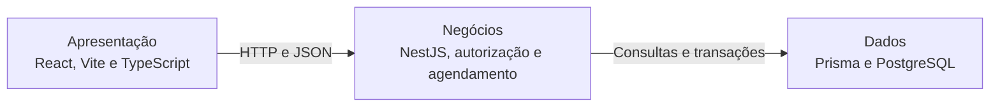

# Agenda do Engenheiro Civil

Projeto individual de Sistemas Distribuídos da UFERSA, de **Lucas Assis da Costa Pereira**, com apresentação em **27/11/2026**. O cliente solicita atendimento para topografia, CAR, serviços relacionados ao INCRA ou projetos. A conta profissional administra todos os pedidos e confirma os horários de visita.

## Execução local

Copie .env.example para .env e preencha POSTGRES_PASSWORD e JWT_SECRET. Use caracteres seguros para URL na senha do banco e pelo menos 32 caracteres no segredo JWT. Para demonstrar o painel, preencha ENGINEER_NAME, ENGINEER_PHONE e ENGINEER_PASSWORD com dados fictícios.

```sh
docker compose up -d --build --wait
docker compose exec api npm run seed
```

Copie o AGENDA_OWNER_ID exibido pelo comando para o .env e execute `docker compose up -d --wait api`. Acesse o [site local](http://localhost:8080) e confira a [saúde da API](http://localhost:3000/saude). O PostgreSQL fica na rede interna do Compose.

Para o e-mail local, use o destinatário e o remetente autorizados do Resend ou configure EMAIL_TEST_URL com a URL de um receptor HTTP de teste alcançável pelo contêiner. Ele deve aceitar POST com `from`, `to`, `subject` e `text` e retornar HTTP 2xx. As suítes já criam um receptor em memória e usam endereços fictícios.

```sh
docker compose exec api npm test
docker compose exec api npm run test:seguranca
docker compose exec api npm run test:profissionais
```

Rode esses comandos somente em banco de teste. As suítes exercitam o envio simulado, confirmação e recuperação, sessão legada e vínculo do e-mail, autorização, persistência durante migração, agendamento concorrente e remarcação. A suíte profissional sobe um schema separado com as três migrações anteriores, insere dados fictícios e aplica a atualização.

## Variáveis de ambiente

| Variável | Uso |
| --- | --- |
| POSTGRES_PASSWORD | Senha do banco no Compose, com caracteres seguros para URL. |
| DATABASE_URL | Conexão Prisma, montada pelo Compose com o endereço interno do banco. |
| JWT_SECRET | Segredo do JWT com pelo menos 32 caracteres. |
| CORS_ORIGINS | Origens de navegador autorizadas, separadas por vírgulas. Em produção, somente o site HTTPS. |
| VITE_API_URL | URL da API incorporada à compilação React. |
| ENGINEER_NAME, ENGINEER_PHONE, ENGINEER_PASSWORD | Conta fictícia para o seed local. |
| AGENDA_OWNER_ID | UUID da conta profissional existente, confirmado com o titular. |
| AGENDA_OWNER_EMAIL | Caixa privada e autorizada usada somente pelo comando de convite. |
| RESEND_API_KEY, EMAIL_FROM | Chave privada de envio e endereço remetente verificado. |
| EMAIL_SITE_URL, EMAIL_TEST_URL | URL do site e receptor simulado para uso local. |
| SITE_DOMAIN, API_DOMAIN | Domínios HTTPS servidos pelo Caddy. |

## Arquitetura



O React envia HTTP e JSON para o NestJS. Apenas a API acessa o banco. Ela verifica em cada operação a assinatura do JWT, a validade da sessão e a autorização com base na conta atual. Sessões vencem após oito horas e são revogadas no logout e após redefinição da senha. Senhas usam scrypt com sal aleatório. O cadastro cria clientes após confirmação do e-mail. A confirmação, o vínculo, a recuperação e o convite usam hashes de tokens de uso único com validade de 20 minutos. A recuperação devolve a mesma mensagem para endereços existentes e inexistentes. As tentativas são limitadas na instância NestJS.

O cliente só acessa pedidos do próprio UUID. O telefone de uma conta legada continua funcionando durante a transição. Em **Minha conta**, o cliente pode vincular um e-mail após confirmar a posse do endereço. Os pedidos continuam associados ao mesmo UUID.

O profissional autorizado é a conta com papel ENGENHEIRO e UUID igual a AGENDA_OWNER_ID. Contas de papéis profissionais anteriores permanecem registradas. A visibilidade de **Quem atende** é uma preferência dessa conta, independente da autorização para operar o painel.

A API aceita dia e hora no início de cada hora de Brasília. Ao agendar, o estado do pedido e a nova visita são gravados juntos. A restrição única de horário impede que dois pedidos ocupem o mesmo horário sob concorrência. A remarcação mantém o ID da visita e verifica se o horário anterior ainda é o que o profissional viu. O React exibe as datas em America/Sao_Paulo.

| Método e rota | Acesso |
| --- | --- |
| GET /saude | Público. Verifica a conexão com o banco. |
| POST /auth/cadastro, /auth/confirmar-email, /auth/login | Público. Cadastro por e-mail e login por e-mail ou celular legado. |
| GET /auth/recursos | Público. Informa se as operações de envio de e-mail estão disponíveis. |
| POST /auth/recuperacao, /auth/redefinir-senha | Público. Recuperação pelo e-mail verificado. |
| POST /auth/vincular-email, /auth/confirmar-vinculo, /auth/sair | Conta autenticada. |
| POST /auth/ativar-profissional | Convite de uso único emitido pelo operador para a conta do titular. |
| GET /profissionais/publico | Público. Identificação autorizada pelo titular. |
| GET e POST /profissionais/meu-perfil | Profissional autorizado. |
| GET /pedidos e /pedidos/:id | Cliente consulta os próprios pedidos. Profissional consulta todos, com filtros. |
| POST /pedidos e /pedidos/:id/respostas | Cliente. A resposta exige propriedade e pergunta em aberto. |
| POST /pedidos/:id/informacoes e /pedidos/:id/conclusao | Profissional autorizado. |
| GET e POST /visitas, POST /visitas/remarcacao | Profissional autorizado. |

## Atualização na EC2

1. Confira o checkout, os serviços em execução, a origem do volume PostgreSQL, a região e os registros DNS. No banco atual, consulte a tabela _prisma_migrations para conhecer as migrações realmente aplicadas.
2. Confirme com o titular qual UUID corresponde à conta profissional existente. Faça backup privado do PostgreSQL com pg_dump em formato customizado e valide com pg_restore --list. Guarde também a revisão anterior e a configuração privada para eventual retorno.
3. Restaure em um banco isolado e ensaie `prisma migrate deploy` com a nova imagem. Compare as quantidades e os vínculos de contas, pedidos e visitas antes e depois. Use uma configuração de ensaio separada que bloqueie envio para clientes reais.
4. Configure AGENDA_OWNER_ID no ambiente privado de publicação. Configure o remetente verificado e a chave de envio do Resend. Desative rastreamento de links nos e-mails de autenticação. Teste o acesso do titular em uma instância privada com a cópia e confirme o recebimento em uma caixa autorizada. [API de envio do Resend](https://resend.com/docs/api-reference/emails/send-email)
5. Quando o titular precisar escolher a senha, informe a caixa autorizada em AGENDA_OWNER_EMAIL no ambiente privado do processo e execute `npm run convidar:profissional` no contêiner da versão correspondente. O comando envia um link ao titular. Ele abre o link, cria a senha e entra em **Área do profissional** com o e-mail e a senha. Com credenciais legadas válidas, ele também pode usar **Já tenho conta por celular**, entrar e vincular o e-mail em **Minha conta**.
6. Após a validação privada, aplique a versão revisada da origin/main com o mesmo projeto Compose e o mesmo volume. Use os domínios existentes, confira o SHA e teste a entrega real. Planeje o retorno dos serviços para a imagem anterior e preserve qualquer pedido recebido depois da atualização caso seja necessária uma restauração.

```dotenv
SITE_DOMAIN=lucas.grupo-04.sd.ufersa.dev.br
API_DOMAIN=api.lucas.grupo-04.sd.ufersa.dev.br
CORS_ORIGINS=https://lucas.grupo-04.sd.ufersa.dev.br
VITE_API_URL=https://api.lucas.grupo-04.sd.ufersa.dev.br
```

```sh
git rev-parse HEAD
docker compose -f compose.yaml -f compose.publicacao.yaml up -d --build --wait
curl -fsS -o /dev/null https://lucas.grupo-04.sd.ufersa.dev.br/
curl -fsS https://api.lucas.grupo-04.sd.ufersa.dev.br/saude
```

## Apresentação de 27/11/2026

Na versão acadêmica, o cadastro e a recuperação por e-mail ficam indisponíveis enquanto o envio estiver sem configuração. As duas contas fictícias são provisionadas pelo operador, fora do cadastro público. O procedimento não verifica nem vincula endereços de e-mail.

1. As contas já estão provisionadas. Antes da apresentação, obtenha as senhas correspondentes no arquivo privado `/opt/agenda/.demonstracao.env`, em um terminal administrativo autorizado da EC2, sem compartilhar a tela. Se for necessário reprovisionar, carregue o arquivo com `set -a; . /opt/agenda/.demonstracao.env; set +a` e execute `docker exec -e DEMO_CLIENTE_A_SENHA -e DEMO_CLIENTE_B_SENHA agenda-api-1 npm run seed:demonstracao`. O comando cria somente as contas fictícias de cliente.
2. Em dois perfis de navegador, abra **Entrar** → **Já tenho conta por celular**. Use `11900000001` para o cliente A e `11900000002` para o cliente B, cada um com a senha correspondente.
3. Em um terceiro perfil, abra **Área do profissional** no rodapé e escolha **Já tenho conta por celular**. Entre com `11900000003` e a senha `DEMO_PROF_SENHA` do arquivo privado `/opt/agenda/.profissional-demonstracao.env`. Consulte-o apenas em uma sessão administrativa autorizada na EC2. A conta temporária já está ativa e é a única selecionada para o painel. A conta profissional anterior e suas credenciais foram preservadas. Após a demonstração, saia das três sessões.

Use duas sessões de cliente de teste e uma sessão profissional autorizada, em perfis de navegador separados. No painel **Rede**, mostre **Método**, **Status** e as abas de corpo e resposta JSON. Oculte cabeçalhos de autenticação e use apenas dados fictícios.

| Tempo | Demonstração |
| --- | --- |
| 0:00–0:40 | Abra os dois domínios HTTPS e mostre `GET /saude` com **200**. Mostre os registros no Route 53 e os destinos do Caddy em `deploy/Caddyfile` após confirmar a configuração no host. |
| 0:40–1:25 | Entre como cliente de teste, envie um pedido de **Topografia** com a referência “Porteira depois do galpão” e mostre **Pedido recebido** e `POST /pedidos` com **201**. Siga o formulário em `frontend/src/main.tsx`, o controller e o serviço em `backend/src/main.ts` e o modelo `Pedido` em `backend/prisma/schema.prisma`. |
| 1:25–2:20 | Entre pelo rodapé com a conta profissional, confirme uma visita futura e mostre `POST /visitas` com **201**. No cliente, atualize **Meus pedidos** e confira o dia e a hora de Brasília. |
| 2:20–3:00 | Mostre `GET /pedidos` sem sessão (**401**), `POST /visitas` com sessão de cliente (**403**) e `GET /pedidos/:id` com a sessão do segundo cliente (**404**). |

Exemplo de corpo para `POST /pedidos`. O link do mapa pode ser omitido.

```json
{
  "servico": "Topografia",
  "municipio": "Mossoró",
  "comunidade": "Sítio fictício",
  "local": "Porteira depois do galpão",
  "descricao": "Levantamento de terreno"
}
```

### Evidências da publicação acadêmica

A versão `a48546ed28def5ef9761067ae9f529b22b17e05c` foi publicada em 24/11/2026. As imagens de interface e API informam o mesmo SHA. O PostgreSQL recebeu backup antes da migração, e as contagens de contas, pedidos e visitas foram comparadas antes de criar as contas fictícias.

| Critério | Verificação |
| --- | --- |
| Três camadas | A EC2 serve o React e executa NestJS e PostgreSQL em serviços separados. O React chama `POST /pedidos` em `frontend/src/main.tsx`, o NestJS autoriza e persiste em `backend/src/main.ts` e Prisma usa os modelos de `backend/prisma/schema.prisma`. O pedido criado pela API pública foi conferido na tabela `Pedido` do PostgreSQL. |
| API HTTP | Por HTTPS, `POST /pedidos` devolveu **201** com `{"servico":"Topografia","situacao":"RECEBIDO"}` no recorte da resposta. O pedido fictício usa a referência “Porteira laranja - teste academico 27/11”. |
| DNS | O Route 53 tem dois registros A com TTL de 60 segundos para `50.16.228.161`. O Caddy encaminha os domínios a `web:8080` e `api:3000`. O site e `GET /saude` passaram em HTTPS com **200**. |
| Autenticação e autorização | Os clientes fictícios e o profissional temporário fizeram login com **201**. Na API pública, o profissional abriu Pedidos e Agenda com **200** e `POST /visitas` retornou **201**. O cliente consultou o pedido com **200** e recebeu a confirmação de **27/11/2026 às 13:00**, horário de Brasília. A API devolveu **401** sem sessão, **403** em `POST /visitas` por um cliente e **404** ao tentar ler o pedido com o segundo cliente. |

No Chrome, a capa foi conferida em 390 e 1440 pixels. Sem remetente configurado, cadastro e recuperação mostram o aviso de indisponibilidade, e a API devolve **503** em ambos.
