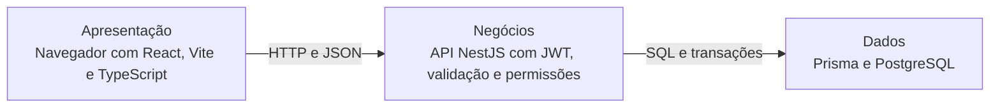

# Agenda do Engenheiro Civil

Projeto final individual de Sistemas Distribuídos da UFERSA, de **Lucas Assis da Costa Pereira**, com apresentação em **27/11/2026**. A agenda organiza pedidos de visita relacionados a topografia, CAR, INCRA e projetos. O engenheiro pode revisar os pedidos por município e comunidade e reservar horários pela agenda.

## Executar com Docker Compose

Com Docker e Compose disponíveis, copie `.env.example` para `.env` na raiz. No PowerShell, use `Copy-Item .env.example .env`. Em Linux, use `cp .env.example .env`.

```sh
docker compose up -d --build --wait
docker compose exec api npm run seed
```

Abra [o frontend local](http://localhost:8080). A API está em [localhost:3000](http://localhost:3000/saude). A API aplica as migrações versionadas na inicialização e o PostgreSQL fica na rede interna do Compose.

Cadastre um cliente fictício pela interface. Use, por exemplo, **Ana Demo**, **(84) 99900-0010** e uma senha de demonstração com pelo menos oito caracteres. Para o engenheiro, use o celular e a senha definidos no seu `.env`. O comando `seed` cria ou atualiza a conta de engenheiro para o número configurado e recusa se o número já for de um cliente. Use janelas ou perfis separados para manter ambas as sessões abertas durante a demonstração.

```sh
docker compose exec -e TEST_API_URL=http://localhost:3000 api npm test
docker compose down
```

Execute a suíte apenas contra um banco de demonstração. Ela cria registros fictícios e verifica cadastro e login com normalização, propriedade dos pedidos, permissões, filtros, troca de mensagens, confirmação e conclusão. Também disputa o mesmo horário entre dois pedidos e disputa horários diferentes para o mesmo pedido.

## Variáveis de ambiente

| Variável | Uso |
| --- | --- |
| `POSTGRES_PASSWORD` | Senha do banco no Compose. Use caracteres seguros para URL, como letras, números, hífen e sublinhado. |
| `DATABASE_URL` | Conexão Prisma. O Compose monta o valor com o endereço interno `db`. |
| `JWT_SECRET` | Segredo do JWT com pelo menos 32 caracteres. |
| `CORS_ORIGINS` | Origens autorizadas, separadas por vírgulas. |
| `VITE_API_URL` | URL da API incorporada durante a compilação do frontend. |
| `ENGINEER_NAME`, `ENGINEER_PHONE`, `ENGINEER_PASSWORD` | Credenciais configuradas fora do Git para o comando `seed`. |
| `SITE_DOMAIN`, `API_DOMAIN` | Domínios do proxy HTTPS. |
| `TEST_API_URL` | Endereço da API de demonstração usado pela suíte. |

## Arquitetura



O navegador guarda o JWT na sessão da aba e envia o token no cabeçalho `Authorization: Bearer`. A senha é derivada com scrypt e sal por conta. A API aplica as permissões de acordo com o papel autenticado e filtra os pedidos de cliente pelo identificador da conta.

A API recebe dia e hora no fuso de Brasília, aceita somente o início de cada hora e persiste o instante em PostgreSQL. O frontend exibe o mesmo instante em `America/Sao_Paulo`. O agendamento altera a situação e cria a visita em uma única transação. A atualização do pedido exige uma situação válida no banco e o índice único de horário faz uma tentativa concorrente perder com HTTP 409. A perda desfaz a alteração daquele pedido. Há também um índice único por pedido. A conclusão mantém o histórico da visita e a retira da lista de confirmadas.

### Rotas principais

| Método e rota | Acesso |
| --- | --- |
| `GET /saude` | Público. Verifica a conexão com o banco. |
| `POST /auth/cadastro`, `POST /auth/login` | Público. O cadastro cria conta de cliente. |
| `POST /pedidos` | Cliente autenticado. |
| `GET /pedidos`, `GET /pedidos/:id` | Cliente consulta os próprios pedidos. Engenheiro consulta todos e pode filtrar a lista por `municipio` e `comunidade`. |
| `POST /pedidos/:id/informacoes` | Engenheiro. Envia `{ "texto": "..." }`. |
| `POST /pedidos/:id/respostas` | Dono do pedido. Envia `{ "texto": "..." }` quando há solicitação de informações. |
| `POST /pedidos/:id/conclusao` | Engenheiro. |
| `POST /visitas` | Engenheiro. Envia `pedidoId`, `dia` no formato AAAA-MM-DD e `hora` no formato HH:00. |
| `GET /visitas` | Engenheiro. Lista as visitas confirmadas por horário. |

## Publicação no AWS Academy

O Compose de publicação foi preparado para um host Linux com Docker Compose e acesso autorizado à zona DNS. Antes de apontar qualquer domínio, inventarie os registros existentes e valide com o responsável qual infraestrutura serve cada nome. Preserve as entradas das avaliações anteriores. Em uma instância autorizada, use um endpoint estável e libere 80 e 443 no grupo de segurança. Restrinja o acesso administrativo e mantenha o PostgreSQL na rede interna.

No `.env` do host, use segredos próprios e ajuste:

```dotenv
SITE_DOMAIN=lucas.grupo-04.sd.ufersa.dev.br
API_DOMAIN=api.lucas.grupo-04.sd.ufersa.dev.br
CORS_ORIGINS=https://lucas.grupo-04.sd.ufersa.dev.br
VITE_API_URL=https://api.lucas.grupo-04.sd.ufersa.dev.br
```

```sh
docker compose -f compose.yaml -f compose.publicacao.yaml up -d --build --wait
docker compose -f compose.yaml -f compose.publicacao.yaml exec api npm run seed
```

O Caddy solicita e renova os certificados quando os domínios apontam para o proxy e as portas estão acessíveis. Confirme o DNS e faça a verificação de HTTPS antes de entrar com qualquer conta. O site deve retornar HTTP 200 e a saúde da API deve retornar `{"ok":true}`.

```sh
curl -fsS -o /dev/null https://lucas.grupo-04.sd.ufersa.dev.br/
curl -fsS https://api.lucas.grupo-04.sd.ufersa.dev.br/saude
```

## Roteiro de apresentação, três minutos

| Tempo | Demonstração |
| --- | --- |
| 0:00–0:35 | Apresente o problema. Um profissional autônomo recebe pedidos de localidades diferentes e precisa agrupá-los para organizar as visitas. Mostre rapidamente as três camadas. |
| 0:35–1:20 | No celular, entre como cliente fictício, escolha Topografia, escreva o município e uma referência fictícia e envie. Mostre a confirmação e o estado **Pedido recebido**. |
| 1:20–2:10 | No computador, entre como engenheiro, filtre pelo município, abra a ação **Marcar visita**, selecione um horário futuro e confirme. Mostre o próximo compromisso na **Agenda**. |
| 2:10–2:40 | Volte ao celular, atualize **Meus pedidos** e mostre **Visita marcada** com dia e hora de Brasília. |
| 2:40–3:00 | Explique a transação e a restrição única no banco. Se dois agendamentos disputam a mesma hora, uma confirmação é salva e o outro pedido preserva sua situação. |
