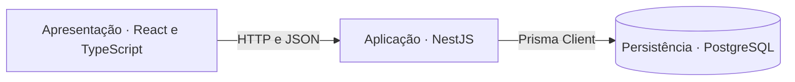

# Arquitetura

A Agenda tem três camadas. O navegador envia requisições HTTP com JSON para a API. A API acessa o PostgreSQL pela rede interna do Docker.

| Camada | Responsabilidade |
| --- | --- |
| Apresentação | React mantém as telas e os formulários. O Vite compila os arquivos estáticos e o Nginx os serve no contêiner web. [Aplicação React](../frontend/src/main.tsx) · [Imagem web](../frontend/Dockerfile) |
| Aplicação | NestJS recebe as chamadas, valida os dados, autentica a sessão e aplica as permissões e transições do pedido. [Controllers, guard e serviço](../backend/src/main.ts) · [DTOs](../backend/src/dto.ts) |
| Persistência | Prisma traduz as operações do serviço em consultas e transações. PostgreSQL mantém contas, sessões, pedidos, mensagens, visitas e tokens de e-mail. [Conexão Prisma](../backend/src/db.ts) · [Schema](../backend/prisma/schema.prisma) · [Migrações](../backend/prisma/migrations) |

## Do pedido de topografia à confirmação

1. Em **Pedir atendimento**, `NovoPedido` reúne tipo de serviço, município, referência e descrição. Se o cliente ainda estiver deslogado, o login respeita esse destino e abre o formulário. A interface envia `POST /pedidos` com o JWT da sessão.
2. O guard `Autenticacao` valida a sessão. O NestJS valida `PedidoDto`, e `PedidosService.criar` exige o papel `CLIENTE` e associa o UUID da sessão a `clienteId`. O PostgreSQL aplica o estado inicial `RECEBIDO`. A resposta inclui o pedido, as mensagens e a visita, inicialmente `null`.
3. Em **Pedidos**, a conta profissional selecionada consulta `GET /pedidos` e pode filtrar por município e comunidade. Ao confirmar uma visita, envia `POST /visitas` com o UUID do pedido, a data e a hora de Brasília.
4. A API valida o horário e grava a visita junto com a mudança para `MARCADO` na mesma transação. Quando o cliente reabre **Meus pedidos**, `GET /pedidos` devolve os pedidos do próprio UUID com as respectivas visitas. A interface formata a data em `America/Sao_Paulo`.

[Exemplos completos da troca HTTP](api.md).

## Sessão e permissões

O login assina um JWT com o UUID da conta, o identificador da sessão e a versão de sessão da conta. O guard verifica a assinatura e a expiração do JWT, busca `SessaoAcesso` no banco e compara o vínculo com a conta e sua versão atual. A sessão dura oito horas. O logout revoga aquela sessão. Redefinir a senha ou ativar a conta profissional incrementa a versão e remove as sessões anteriores da conta. [Implementação da autenticação](../backend/src/main.ts).

O cliente só consulta e responde a pedidos do próprio UUID. O painel exige papel `ENGENHEIRO` e UUID igual a `AGENDA_OWNER_ID`, mesmo se houver outras contas com papel profissional no banco. A autorização para exibir o perfil em **Quem atende** é uma preferência do titular. O cadastro público cria contas `CLIENTE`. O fluxo de convite por e-mail usa a conta profissional selecionada e o endereço privado configurado em `AGENDA_OWNER_EMAIL`. [Autenticação e perfil](../backend/src/main.ts) · [Tokens de e-mail](../backend/src/email.ts).

## Regras da agenda

A API exige data futura e minuto `00` no fuso de Brasília. A marcação aceita pedidos em `RECEBIDO` ou `INFORMACOES`. A remarcação exige `MARCADO` e compara `horarioAnterior` com o horário salvo. O PostgreSQL aplica unicidade em `Visita.pedidoId` e `Visita.horario`. Se duas marcações disputarem um horário, a que perder devolve **409** e a transação mantém o pedido no estado anterior. Pedidos concluídos mantêm sua visita no histórico e saem da lista da Agenda. [Regras no serviço](../backend/src/main.ts) · [Restrições no schema](../backend/prisma/schema.prisma) · [Teste concorrente](../backend/test/e2e.mjs).
